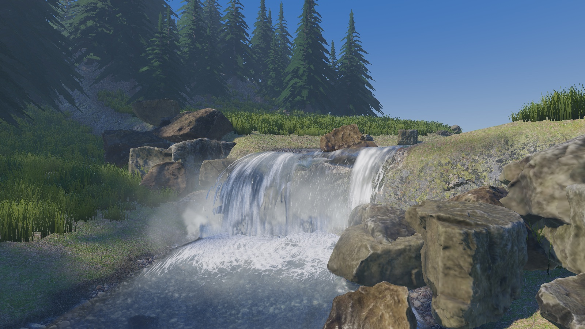
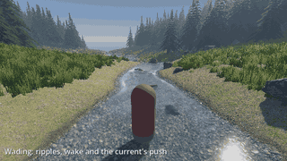
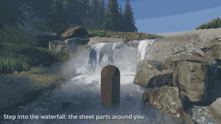
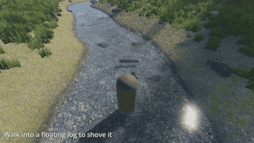
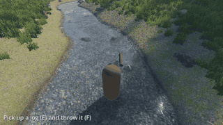
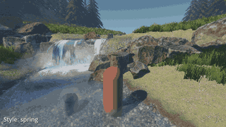
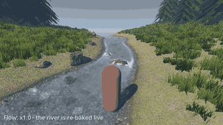

# Flowing Water

Rivers, streams, waterfalls and ponds for **Godot 4.7**. Draw a river down a
slope, press **Bake**, and get water that flows around rocks, pushes the
player, carries floating objects and runs well on a Steam Deck. Pure
GDScript and shaders: no GDExtension, nothing to compile.

<p align="center">
  
</p>

<p align="center">
  <a href="LICENSE"></a>
  
</p>

## In motion

<table>
  <tr>
    <td></td>
    <td></td>
  </tr>
  <tr>
    <td align="center">Wading: ripples, wake, the current's push</td>
    <td align="center">Step into a waterfall and the sheet parts around you</td>
  </tr>
  <tr>
    <td></td>
    <td></td>
  </tr>
  <tr>
    <td align="center">Shove floating logs</td>
    <td align="center">Pick them up and throw them back in</td>
  </tr>
  <tr>
    <td></td>
    <td></td>
  </tr>
  <tr>
    <td align="center">Eight style presets, from glacial to muddy to toon</td>
    <td align="center">More water: the flow is re-baked live</td>
  </tr>
</table>

Recorded in the demo with [`tools/make_gifs.sh`](tools/make_gifs.sh).

## Install

1. Copy [`addons/flowing_water/`](addons/flowing_water) into your project's
   `addons/` folder (or download the repository zip and keep only that folder).
2. **Project → Project Settings → Plugins** → enable **Flowing Water**.

The addon is self-contained and works in an empty project. The full manual
(nodes, baking, styles, gameplay API, underwater, quality presets) is in
[addons/flowing_water/README.md](addons/flowing_water/README.md).

## Try the examples

This repository is itself a Godot project. Clone it, open `project.godot` in
Godot 4.7 and press Play to run the demo, or open any scene in
[`examples/`](examples):

| Scene | Shows |
|---|---|
| `examples/01_stream.tscn` | One `WaterRiver`: curve, width per point, narrows that speed the flow up |
| `examples/02_pond.tscn` | One `WaterPond`: still water, wind ripples, reflections, floating logs |
| `examples/03_waterfall.tscn` | Rapids, a waterfall over a rock ledge, plunge pool with foam and mist |
| `examples/04_river_pond_river.tscn` | Two `WaterJunction`s: stream → pond → outlet |
| `examples/05_styles.tscn` | All eight `WaterStyle` presets on the same stream |
| `examples/06_gameplay.tscn` | Character with `WaterInteractor` and `WaterFloater` logs |
| `examples/07_lowland_river.tscn` | A wide, slow, silty river with mud banks and reeds |
| `examples/demo/demo.tscn` | Everything together, walkable (the main scene) |

The examples are kept outside the addon so they don't end up in your game.

## Repository layout

```
addons/flowing_water/   the addon: the only folder you need in your game
examples/               example scenes, demo and benchmark (Poly Haven CC0 assets)
tools/                  development scripts: checks, screenshots, example builder
docs/                   images for this page
```

## License

Copyright 2026 Piotr Gródek and the Flowing Water contributors. Licensed
under the [Apache License, Version 2.0](LICENSE); see also [NOTICE](NOTICE).

The addon contains no third-party code or assets. The example scenes use
CC0 textures and rock scans from [Poly Haven](https://polyhaven.com)
([list](examples/shared/polyhaven/README.txt)).

## Disclaimer

Flowing Water is a personal, open-source project developed in the author's
spare time, on personal equipment. It is not affiliated with, sponsored or
endorsed by, and does not represent any current or former employer of the
author; the views and code here are the author's own. Names of third-party
projects (Godot Engine, Poly Haven, Steam Deck) are used only to identify
the software, assets and hardware involved and do not imply endorsement by
their owners.

Generative AI tools were used in developing this project, including code
and documentation.

Flowing Water is provided "as is", without warranty of any kind (see the
license). To the maximum extent permitted by applicable law, the author
accepts no liability for any damages or losses arising from its use.
